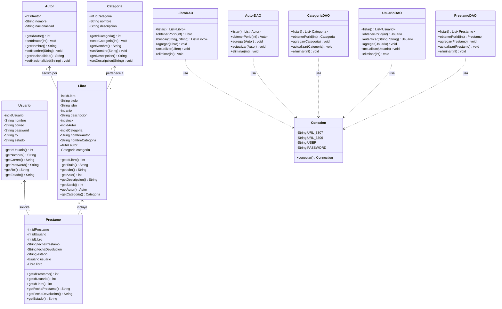

# 📚 BOOKHUB — Sistema Web de Gestión de Biblioteca Universitaria

Aplicación web desarrollada en **Java (Jakarta EE / Servlets / JSP / MVC / DAO con JDBC y MySQL)** manteniendo la estructura original de proyecto **NetBeans / Apache Ant (`build.xml`, `nbproject/`)**, configurada para **Apache Tomcat 10** y **JDK 24**.

---

## 🌱 Compromiso con el ODS 09: Industria, Innovación e Infraestructura

**BOOKHUB** está alineado con el **Objetivo de Desarrollo Sostenible 9 (ODS 09)** de la Agenda 2030 de las Naciones Unidas:
- **Infraestructura Digital Resiliente (Meta 9.1):** Digitalización de la gestión bibliotecaria universitaria.
- **Investigación Científica e Innovación Tecnológica (Meta 9.5):** Colección bibliográfica especializada en la categoría **"ODS 09 - Innovación e Infraestructura"** disponible directamente en el catálogo.
- **Acceso Universal a las TIC (Meta 9.c):** Consulta de stock en tiempo real, registro de lectores y solicitud de préstamos en línea.

---

## 🔑 Usuarios Pre-creados (1 Admin y 2 Lectores)

En la pantalla de **Iniciar sesión (`login.jsp`)** puedes iniciar sesión directamente o usar los botones de autocompletado rápido:

| Rol | Nombre | Correo | Contraseña | Estado |
| :--- | :--- | :--- | :--- | :--- |
| **ADMIN** | Administrador | `admin@bookhub.com` | `123456` | `ACTIVO` |
| **USUARIO (Lector 1)** | Juan Pérez (Lector 1) | `juan@bookhub.com` | `123456` | `ACTIVO` |
| **USUARIO (Lector 2)** | María López (Lector 2) | `maria@bookhub.com` | `123456` | `ACTIVO` |

Además, cualquier nuevo lector puede crear su cuenta desde el apartado **Registrarse (`registro.jsp`)**.

---

## 📐 Diagrama de Clases UML (Entregable 1 y 2 - Evaluación T2 SWAD)



---

## 🗂️ Estructura del Proyecto (NetBeans / Apache Ant)

```text
BookHub/
├── build.xml                        # Script de compilación Apache Ant (NetBeans)
├── nbproject/                       # Configuración de Apache Tomcat 10 y JDK 24
├── database/
│   └── bookhub.sql                  # Script MySQL con tablas y datos semilla
├── src/
│   ├── conf/MANIFEST.MF
│   └── java/
│       ├── beans/                   # Modelo de clases (Autor, Categoria, Libro, Prestamo, Usuario)
│       ├── conexion/                # Clase Conexion JDBC MySQL (puerto 3307 / 3306)
│       ├── dao/                     # Capa DAO con PreparedStatement + respaldo en memoria
│       └── servlets/                # Controladores MVC y filtro de seguridad AdminFilter
└── web/                             # Vistas JSP, index.html y configuración WEB-INF/META-INF
```
